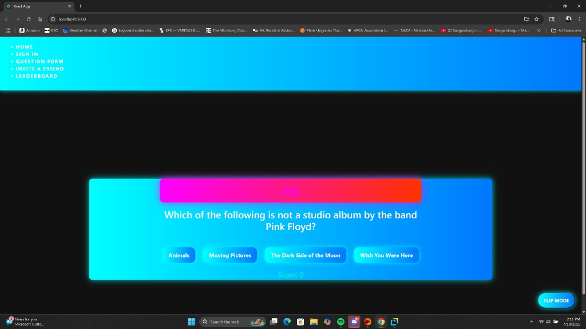

# Trivia Explosion

A timed trivia game with a neon “trivia bomb” on the home screen. Answer before the clock runs out. A correct answer adds time and points. A wrong answer burns the fuse. When the timer hits zero, the bomb goes off and you get a final score.



## What you can do

- **Play Trivia Bomb** on the home page. Questions come from the [Open Trivia Database](https://opentdb.com/) (Entertainment, multiple choice). You start with 15 seconds. A right answer scores a point and adds 5 seconds, up to 30. A wrong answer subtracts 3 seconds. After the round you can play again.
- **Flip Mode** switches the page between light and dark and remembers the choice in the browser.
- **Sign in / sign up**, **create questions**, **invite a friend**, and view a **leaderboard**. Those screens are wired to a Spring Boot API.

The bomb game runs from the React app alone. Sign-in, quizzes, invites, and the leaderboard need the API and MySQL.

## Stack

| Piece | Tech |
| --- | --- |
| UI | React 18, React Router, Bootstrap |
| Game questions | Open Trivia DB |
| API | Spring Boot 3.2, Java 17, Gradle |
| Data | MySQL, Spring Data JPA |

## Run the game locally

You need Node.js.

```bash
cd client
npm install
npm start
```

Open [http://localhost:3000](http://localhost:3000).

## Run the API

You need Java 17 and MySQL.

1. Create a database named `trivia_explosion`.
2. Set the datasource URL, username, and password in `src/main/resources/application.properties`.
3. Start the server:

```bash
./gradlew bootRun
```

On Windows:

```bash
gradlew.bat bootRun
```

The API listens on [http://localhost:8080](http://localhost:8080). The React dev server proxies API calls there.

Main routes:

- `POST /users` and `GET /users/leaderboard`
- `POST /question`, `GET /question/{id}`, `PUT /question/{id}`, `DELETE /question/{id}`
- `GET /quiz/getQuizzes`, `GET /quiz/takeQuiz/{quizId}`, `POST /quiz/submitQuiz/{quizId}`
